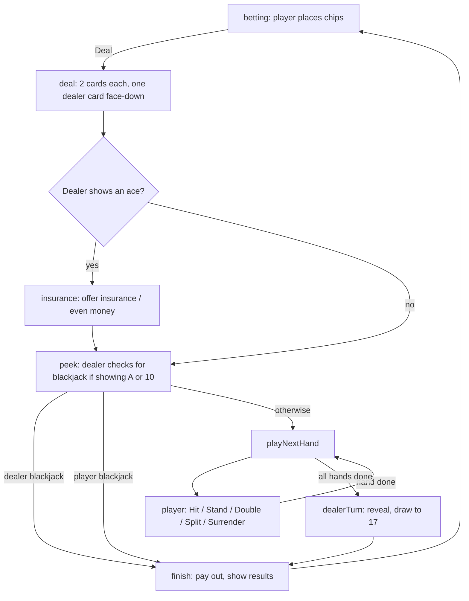

# Blackjack Trainer: How It Works

This guide explains how the blackjack trainer at **https://jcrewse.github.io/blackjack/** is built, how its main features work, and how to make common changes. This guide was generated by Claude - who also generated this code - for the sake of my own understanding of the codebase. It is not intended to be a complete documentation.

---

## 1. The big picture

The whole game is **one file**: `blackjack/index.html`. There is no server, no database, no build step and no external libraries. When someone visits the page, their browser downloads that one file and runs everything itself.

A web page is made of three languages, and this file contains all three:

| Part | Language | What it does | Where in the file |
|---|---|---|---|
| **Structure** | HTML | Declares *what's on the page*: buttons, text areas, the chart dialog | Between `<body>` and `<script>` |
| **Appearance** | CSS | Says *how it looks*: colors, sizes, layout, animations | Inside `<style>` … `</style>` near the top |
| **Behavior** | JavaScript | Says *what happens*: dealing cards, scoring, reacting to clicks | Inside `<script>` … `</script>` near the bottom |

A useful mental model: **HTML is the nouns, CSS is the adjectives, JavaScript is the verbs.**

> **Tip:** The easiest way to find things in the file is your editor's search (Ctrl+F). This guide refers to code by **function names** (like `basicStrategy`) rather than line numbers, because line numbers shift whenever the file is edited.

---

## 2. How the pieces talk to each other

### HTML elements have IDs

Each important element on the page has an `id`, a unique name. For example:

```html
<button id="hit" class="primary">Hit</button>
<strong id="score">0</strong>
```

### JavaScript looks elements up by ID

Near the top of the script, the code collects all the elements it needs into one object called `els` ("elements"):

```js
const els = {
  hit: $('hit'),
  score: $('score'),
  ...
};
```

`$('hit')` is a small shortcut for "find the element whose id is `hit`." After this, the code can write things like `els.score.textContent = 5` to change what's displayed.

### JavaScript listens for clicks and key presses

Near the bottom of the script (the **Wiring** section), each button is connected to the function that should run when it's clicked:

```js
els.hit.addEventListener('click', hit);
```

This reads as "when the Hit button is clicked, run the `hit` function." Keyboard shortcuts work the same way through a single `keydown` listener that maps keys (`h`, `s`, `d`, …) to the same functions.

### CSS classes control appearance

CSS rules target **classes** (names starting with `.`). JavaScript changes how something looks by adding or removing a class rather than editing colors directly. For example, every panel that should be invisible gets the `hidden` class:

```css
.hidden { display: none !important; }
```

and the code shows or hides panels with:

```js
els.betControls.classList.toggle('hidden', !betting);
```

("add the `hidden` class if we're *not* betting, remove it if we are").

---

## 3. The game's "state"

At any moment the game is fully described by a handful of variables declared near the top of the script. Everything you see on screen is drawn from these:

| Variable | Meaning |
|---|---|
| `shoe` | The remaining cards, as a list. Cards are drawn from the end. |
| `dealer` | The dealer's cards. |
| `hands` | The player's hands. Usually one; up to four after splitting. |
| `active` | Which of the player's hands is currently being played (0, 1, 2…). |
| `bank` | The player's money. |
| `bet` | The amount staged for the next round. |
| `insurance` | The insurance bet this round, if any. |
| `phase` | What the game is waiting for (see below). |
| `holeHidden` | Whether the dealer's second card is still face-down. |
| `stats` | The trainer score, best score and accuracy counts. |

A **card** is a small object like `{ r: 'K', s: '♥', id: 17 }` (rank, suit, and a unique ID used for animations).

A **hand** is an object like:

```js
{ cards: [...], bet: 100, split: false, splitAces: false, doubled: false, surrendered: false, result: null }
```

### Phases

The `phase` variable is the key to the whole game. It's always one of:

| Phase | What's happening | What the player can do |
|---|---|---|
| `betting` | Between rounds | Click chips, Deal |
| `insurance` | Dealer shows an ace | Take or decline insurance |
| `player` | Waiting for a decision | Hit, Stand, Double, Split, Surrender, hint |
| `busy` | Cards are being dealt or animated | Nothing (buttons are disabled) |

Every action function starts by checking that it's allowed in the current phase, so pressing a button at the wrong moment simply does nothing.

### The `render()` function

There is one function, `render()`, whose only job is to **make the screen match the state**. It updates the bank, draws cards, shows or hides panels, and enables or disables buttons. The rest of the code follows a simple pattern:

1. Change the state (for example, push a card onto a hand).
2. Call `render()`.

This means you never have to hunt for "the code that updates the Hit button." It's always in `render()`.

---

## 4. How a round plays out



The functions named in the diagram exist in the script under the same names:

- **`deal()`** takes the bet out of the bank, reshuffles if the shoe is low, and deals four cards with a short pause between each (`await sleep(280)`) so it looks like real dealing.
- **`answerInsurance()`** records the insurance choice, then calls `peek()`.
- **`peek()`** checks the dealer's hidden card when it could make a blackjack. If the dealer has one, the round ends immediately.
- **`playNextHand()`** moves to the next hand that still needs a decision. Split hands get their second card here, when their turn comes. Split aces and hands totaling 21 are skipped automatically.
- **`hit()`, `stand()`, `doubleDown()`, `split()`, `surrender()`** are the player's actions. Each one checks it's allowed, records the decision for the trainer (see section 6), changes the hand, and moves on.
- **`dealerTurn()`** flips the hole card and draws until the dealer reaches 17. If every player hand has busted or surrendered, the dealer doesn't bother drawing.
- **`finish()`** uses `settleHand()` to work out each hand's result and payout, adds the winnings to the bank, saves, and returns to the `betting` phase.

> **About `async` / `await`:** Functions marked `async` can pause with `await sleep(…)` without freezing the page. That's how the game paces its animations. While paused, the phase is `busy`, so clicks are ignored.

---

## 5. The blackjack rules in code

### Card values and hand totals

- **`cardValue(card)`** gives 2–10 for number cards, 10 for J/Q/K, and 11 for an ace.
- **`handValue(cards)`** adds the cards up. If the total is over 21 and there's an ace counted as 11, it re-counts that ace as 1. It returns the total and whether the hand is **soft** (still has an ace counted as 11).
- **`isBlackjack(cards)`** means exactly two cards totaling 21. **`isNatural(hand)`** is the same, but excludes split hands, because a 21 after splitting pays 1:1, not 3:2.

### What the player is allowed to do

These small functions decide which buttons are enabled:

| Function | Allowed when… |
|---|---|
| `canAct()` | It's the player's turn |
| `canDouble()` | The hand has exactly 2 cards and the player can afford to match the bet |
| `canSplit()` | 2 cards of equal value, fewer than 4 hands, and the player can afford it |
| `canSurrender()` | First two cards of the original hand (not after splitting) |

### Payouts

`settleHand()` decides each hand's outcome. Payouts are amounts *returned* to the bank, including the original bet:

| Outcome | Returned | Net gain on a $100 bet |
|---|---|---|
| Blackjack | 2.5 × bet | +$150 |
| Win | 2 × bet | +$100 |
| Push (tie) | 1 × bet | $0 |
| Surrender | 0.5 × bet | −$50 |
| Loss / bust | 0 | −$100 |
| Insurance win | 3 × insurance stake | pays 2:1 |

### Settings you can change easily

At the very top of the script are named constants:

```js
const NUM_DECKS = 6;      // decks in the shoe
const RESHUFFLE_AT = ...; // reshuffle when 25% of cards remain
const MAX_HANDS = 4;      // most hands you can split into
const START_BANK = 1000;  // starting money (and reset amount)
const MIN_BET = 5;        // below this you're "out of chips"
```

Changing these is safe. Keep in mind that the trainer's strategy (section 6) is tuned for 6 decks.

---

## 6. The trainer: scoring decisions

### Basic strategy

**Basic strategy** is the mathematically best play for every combination of your hand and the dealer's face-up card, assuming you don't count cards. It's encoded in one function, **`basicStrategy(cards, upCard, avail)`**, which returns `'hit'`, `'stand'`, `'double'`, `'split'` or `'surrender'`.

The function checks, in order:

1. **Pairs:** should this pair be split? (for example, always split aces and 8s, never split 10s)
2. **Surrender:** hard 16 against a dealer 9, 10 or ace, and hard 15 against a 10.
3. **Soft totals** (hands with an ace counted as 11).
4. **Hard totals** (everything else).

The `avail` argument says which optional plays are possible right now (for example, you can't double with three cards). When the ideal play isn't available, the function falls back to the next-best one. That's why the chart has two kinds of double: **D** (double, otherwise hit) and **Ds** (double, otherwise stand).

The strategy is for these house rules: **6 decks, dealer stands on soft 17, double after split allowed, late surrender.** Insurance and even money are always declined.

### Grading

Every action function calls **`grade(action)`** *before* changing anything. `grade` does the following:

1. Asks **`optimalDecision()`** for the correct play in the current situation.
2. Compares it with what the player chose.
3. Updates `stats`:
   - **Correct:** score +1, correct count +1, and best score updates if beaten.
   - **Wrong:** score resets to 0.
   - Total decisions +1 either way. Accuracy = correct ÷ total.
4. Writes a message under the buttons, such as *"✓ Stand is correct: hard 12 vs dealer 4."*

If the player used the hint for this decision, `grade` shows the message but doesn't count the decision at all.

### The hint button and strategy chart

Clicking **💡 Show best move** runs **`showHint()`**, which does the following:

1. Resets the score to 0 (the price of a hint).
2. Marks this decision as "hinted" so it won't be scored.
3. Puts a pulsing outline on the correct button.
4. Calls **`openChart()`** to show the strategy chart.

The chart is a `<dialog>` element, a built-in HTML pop-up that provides the dimmed background and closing with Esc for free.

**The chart is generated, not typed in.** When the page loads, **`buildChart()`** loops over every row (hard 5–17+, soft A,2–A,9, pairs 2,2–A,A) and every dealer card (2–A), builds a sample hand, and asks `basicStrategy` what to do. The answer becomes the cell's letter and color. Because the chart and the grader use the **same function**, they can never disagree. If you ever change the strategy, the chart updates itself.

To highlight the current situation:

- **`chartPosition()`** works out which table, row and column match the player's hand. For example, a 3-card soft 18 against a dealer 9 is the soft table, row "A,7", column "9".
- **`highlightChart()`** adds CSS classes to fade the other tables and cells, turn the row and column labels gold, and enlarge and pulse the matching cell.
- If the chart's first choice isn't allowed (like **R** on a 3-card hand, because surrender is only allowed on the first two cards), the headline explains what to do instead.

Chart colors are defined once in CSS:

```css
.c-H { background: #e57373; }  /* Hit: red */
.c-S { background: #ffd54f; }  /* Stand: yellow */
.c-D { background: #64b5f6; }  /* Double: blue */
.c-P { background: #81c784; }  /* Split: green */
.c-R { background: #ce93d8; }  /* Surrender: purple */
```

Change a color here and it changes everywhere: chart cells, the legend and the answer pill.

---

## 7. Saving progress

The game remembers the bank and trainer stats between visits using **`localStorage`**, a small storage area the browser keeps for each website. Two entries are used:

| Key | Contents |
|---|---|
| `blackjack-bank` | The bank balance, e.g. `"1250"` |
| `blackjack-trainer` | Trainer stats, e.g. `{"score":3,"best":12,"correct":40,"total":46}` |

Things to know:

- The data lives **in each visitor's own browser**, not on GitHub. Nobody else can see it, and it doesn't follow a player to another device or browser.
- Players can reset stats with the **reset stats** link, or reset the bank when they run out of chips.
- Clearing browser data for the site erases both.
- The bet is taken from the bank and saved at the moment of dealing, so refreshing the page mid-hand can't be used to undo a losing hand.

The functions involved are `loadBank` / `saveBank` and `loadStats` / `saveStats`. They're wrapped in `try … catch` so the game still works (just without saving) in browsers where storage is blocked.

---

## 8. Making changes

### Trying changes on your own computer

You don't need a server. Save `index.html` and **double-click it** to open it in your browser. After editing, refresh the page (F5) to see the change.

If something breaks, open the browser's **developer tools** (F12, or right-click → *Inspect*) and look at the **Console** tab. JavaScript errors appear there in red, with the line number where they happened.

### Common edits

| I want to… | Change this |
|---|---|
| Start with more money | `START_BANK` at the top of the script |
| Change chip values | The `<button class="chip" data-v="…">` lines in the HTML, plus the matching `.chip[data-v="…"]` color rules in the CSS |
| Change the table color | `--felt` and `--felt-dark` at the top of the CSS |
| Change chart colors | The `.c-H`, `.c-S`, … rules in the CSS |
| Change button text | The text between `<button …>` and `</button>` in the HTML |
| Make the dealer hit soft 17 | In `dealerTurn()`, change the loop condition (see below). **Also** update `basicStrategy`, because a few plays differ under that rule. |

Making the dealer hit soft 17 means changing:

```js
while (live && handValue(dealer).total < 17) {
```

to:

```js
while (live && (handValue(dealer).total < 17 ||
               (handValue(dealer).total === 17 && handValue(dealer).soft))) {
```

### Publishing changes

The live site updates automatically whenever `blackjack/index.html` changes on the `main` branch of the `Jcrewse/jcrewse.github.io` repository:

1. **Easiest:** on github.com, open the repository, navigate to `blackjack/index.html`, click the pencil icon, make your edit, and click **Commit changes**.
2. **Or** commit and push from your computer with git.

Either way, GitHub's "Build and Deploy" workflow (under the repo's **Actions** tab) rebuilds the site. It's usually live within a few minutes. If a change doesn't appear, check the Actions tab for a failed run, then hard-refresh the page (Ctrl+Shift+R) to bypass the browser's cache.

---

## 9. Map of the file

In order from top to bottom:

1. **`<style>`**: all the CSS, grouped by area (layout, cards, buttons, trainer bar, strategy chart, phone-size adjustments under `@media (max-width: 520px)`).
2. **`<body>`**: the HTML: header and bank, trainer bar, dealer area, message line, player area, bet controls, insurance controls, play controls, hint button, feedback line, the chart `<dialog>`, and the footer with the rules.
3. **`<script>`**: the JavaScript, in labeled sections:
   - Constants and the `els` element lookup
   - State variables
   - **Persistence:** saving and loading
   - **Cards:** shoe, drawing, hand values
   - **Rules for available actions:** `canDouble`, `canSplit`, …
   - **Basic strategy:** `basicStrategy`, `optimalDecision`, `grade`
   - **Strategy chart:** `buildChart`, `chartPosition`, `highlightChart`, `openChart`, `showHint`
   - **Rendering:** `render` and helpers for drawing cards
   - **Betting:** chips and bank reset
   - **Round flow:** `deal` → `peek` → `playNextHand` → actions → `dealerTurn` → `finish`
   - **Wiring:** connecting buttons and keys to functions
   - Start-up: build the shoe, build the chart, draw the first screen
